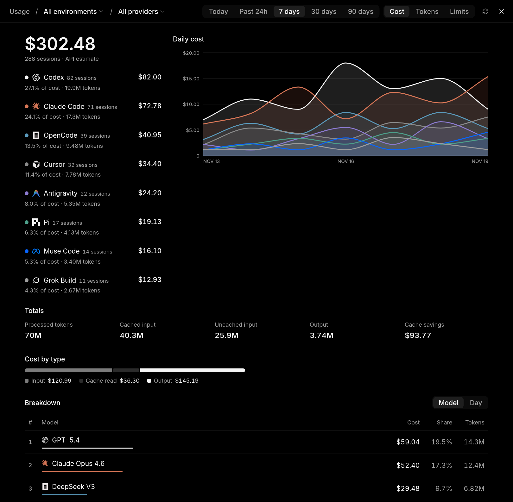

# ModelGauge

ModelGauge is a Tauri tray app for tracking AI model usage, estimated cost, and provider limits across Windows, WSL, macOS, and Linux.



*Sample data from Codex, Claude Code, OpenCode, Cursor, Antigravity, Pi, Muse Code, and Grok Build.*

## Download

Get the package for your machine from [GitHub Releases](https://github.com/ibrahimshadev/modelgauge/releases/latest).

| Platform | Package |
| --- | --- |
| Windows x64 | Run the setup executable, or extract the entire portable ZIP and open `modelgauge.exe`. The app uses WebView2. |
| Windows with WSL | Use the Windows package. Your Windows environment and installed WSL distributions appear in the same report. The included Linux worker supports glibc distributions. |
| Linux x64 | Install the Debian package or make the AppImage executable and open it. For hosts without FUSE, launch with `APPIMAGE_EXTRACT_AND_RUN=1`. |
| macOS 13.5 or later | Choose the Apple Silicon or Intel ZIP and move ModelGauge.app to Applications. The apps are ad hoc signed and unnotarized. |

Click the tray icon to open the report. On Windows and macOS, click it again to hide the panel. Linux desktops with an indicator menu provide **Open ModelGauge** there. The × button returns the app to the tray. Pass `--tray` to start hidden.

## Read the report

**Cost** and **Tokens** share a graph, per-provider totals and a breakdown you can drill into by model. Choose **Today** for midnight through now in your local time zone, **Past 24h** for the rolling window, or 7, 30 or 90 days. Use the two menus next to **Usage** to filter by environment or provider. Under **All environments → Model prices**, add custom input, output and cache rates per million tokens, or map a provider’s model ID to the model you want reported. Select the environments where those edits apply. Subscription totals represent token usage valued at model rates and can differ from the invoice.

**Limits** reads the quota windows exposed by signed-in providers and groups matching accounts across environments. Open an account’s quota bar for its details. When the provider offers reset credits, choose **Use reset** (or **Use** for a named credit), review the confirmation, and select **Use credit**. This spends a real credit on that provider account and affects its other clients. Choosing **Cancel** leaves the credit available. Reset support depends on the provider, platform, and account. Claude credit redemption uses the provider’s Windows/Linux credential flow. The app can also read configured CLIProxyAPI hubs that provide a literal management key. External secret resolvers and quotas available only inside a live agent session are outside this standalone build.

## Data and attribution

The `vendor/t3` directory contains a copy of the Usage UI, shared accounting and provider readers from [T3 Code](https://github.com/pingdotgg/t3code/tree/c80d450d20d6f88f98105b9e67ae47f5b5113fde), copyright T3 Tools Inc., under the [MIT license](vendor/LICENSE-T3). ModelGauge adds the desktop tray, local report workers, and the bridge to Windows and WSL.

A worker runs in each selected operating-system environment and reads its local provider records. The Windows app receives aggregate reports. It counts shared transcript directories once across Windows and WSL. On startup and when you refresh usage, ModelGauge reads retained transcript history from T3 and adds entries missing from its own cache. This includes sessions whose original files have been deleted. Edits are written to ModelGauge’s own data directory. For pricing or eligibility the workers may contact the upstream price list, provider services and configured hubs. Claude’s CLI quota probe sends control messages without starting a model turn. Credentials stay in the worker that reads them.

| Native environment | ModelGauge worker data |
| --- | --- |
| Windows | `%LOCALAPPDATA%\ModelGauge\data` |
| Linux / WSL | `$XDG_DATA_HOME/modelgauge`, default `~/.local/share/modelgauge` |
| macOS | `~/Library/Application Support/ModelGauge` |

Set `MODELGAUGE_HOME` in a worker’s environment to override its data directory. Each worker uses the provider homes available to its OS user. For a non-default T3 state location, set `T3CODE_HOME` in that environment.

## Build and verify

Use Node 24, npm, Rust and [Tauri’s native platform prerequisites](https://v2.tauri.app/start/prerequisites/). Windows requires the MSVC C++ build tools. Each operating system needs its own node_modules directory.

```sh
npm ci
npm run build
npm test
cargo test --manifest-path src-tauri/Cargo.toml
npm run package
```

The Tauri bundler writes installers to `src-tauri/target/release/bundle` (or the equivalent `CARGO_TARGET_DIR`). The JS build pins and verifies the Node binaries used by the reporting workers. For a cross-build, set `MODELGAUGE_TARGET` to the Rust target triple before running the build.

On Windows, run `npm run test:desktop` and `npm run test:popovers` after packaging. Both suites use the actual WebView2 app with an isolated profile. Set `MODELGAUGE_EXECUTABLE` to test a different release executable and `MODELGAUGE_SCREENSHOTS` to save popover captures. The tests exercise reset confirmation with synthetic credits. The report tests use temporary homes and a local provider fixture for pricing, matching, persistence and redemption.

Pushing a version tag matching `package.json` (for example, `v0.1.2`) starts the [release workflow](.github/workflows/release.yml). GitHub builds the packages on hosted runners and publishes them with SHA-256 checksums after every platform succeeds.
